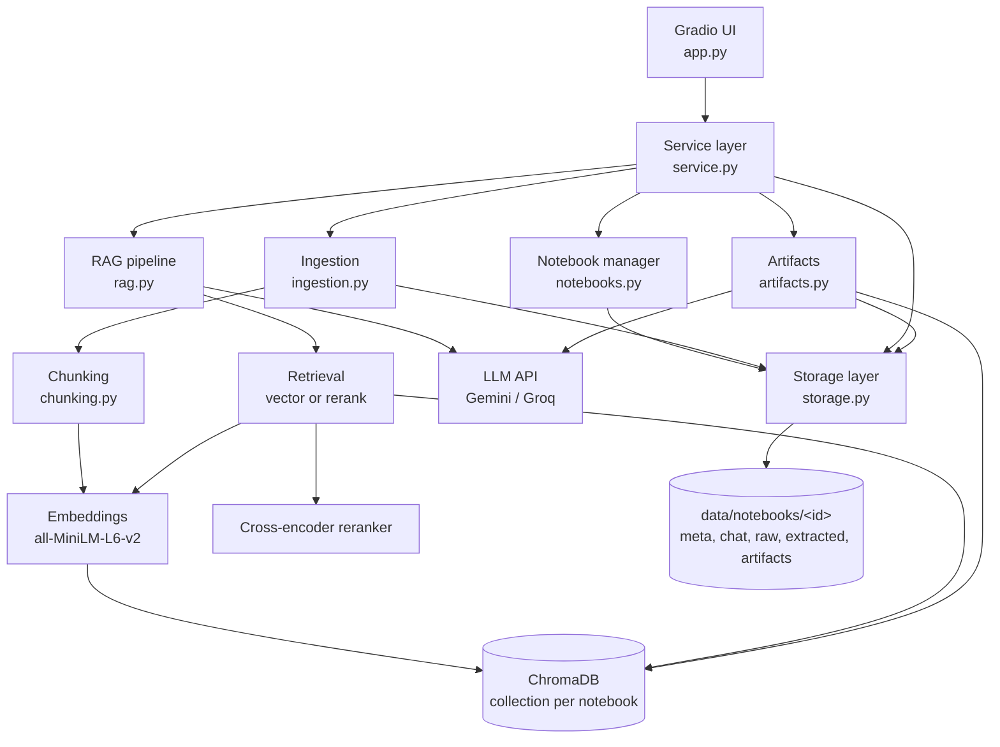

# Architecture

## Diagram



Plain-text version:

```
                    Gradio UI (app.py)
                           |
                 Service layer (service.py)
     ______________|_______|________|_____________
    |              |                |             |
 Notebooks     Ingestion         RAG Chat      Artifacts
    |              |                |             |
    |          Chunking         Retrieval  ---> LLM <---
    |              |           /    |    \
    |          Embeddings ----     Reranker
    |              |                |
    |              +----> ChromaDB <+
    |
 Storage layer (storage.py) -> data/notebooks/<id>/...
```

## Major modules

| Module | Responsibility |
|---|---|
| `app.py` | UI layout and event handlers only. Converts errors into readable messages. |
| `service.py` | Single entry point for the UI. Coordinates ingestion, chat, and artifacts. |
| `storage.py` | Storage abstraction. The only module that touches file paths. Validates notebook IDs, writes JSON atomically. |
| `notebooks.py` | Create, rename, delete, list notebooks. Delete also removes the vector collection. |
| `ingestion.py` | Extracts text from PDF (per page), PPTX (per slide, tables, notes), TXT, and URLs (strips nav/scripts). |
| `chunking.py` | Splits text into ~1000-char chunks with 150-char overlap, snapping to paragraph/sentence boundaries. Attaches citation metadata. |
| `embeddings.py` | Loads the sentence-transformers model once (lazily) and embeds text. |
| `vectorstore.py` | ChromaDB wrapper: add, query, get all, delete by source, delete notebook. |
| `retrieval.py` | The two retrieval strategies: vector search and vector + reranking. Times each call. |
| `llm.py` | OpenAI-compatible client, so the provider can be changed with env variables. |
| `rag.py` | Builds the grounded prompt, calls the LLM, extracts which citations were used. |
| `artifacts.py` | Picks chunks evenly across all sources, generates report or quiz, saves `.md`. |

## Data flow

**Adding a source**
1. User uploads a file or enters a URL.
2. `ingestion.py` extracts text into sections (one per page or slide).
3. Raw file and extracted text are saved under the notebook folder.
4. `chunking.py` splits each section and attaches metadata.
5. `embeddings.py` embeds the chunks, `vectorstore.py` stores them in the notebook's collection.
6. The source is added to the notebook's `meta.json`.

**Asking a question**
1. Question is embedded.
2. Top-k chunks are retrieved from the notebook's collection (optionally reranked).
3. Chunks are numbered and placed in a prompt that tells the LLM to answer only from them and cite `[n]`.
4. The answer plus a Sources list is shown and saved to `chat.json`.
5. The retrieved chunks, scores, and timing appear in the UI.

**Generating an artifact**
1. Chunks are sampled evenly from every source (up to ~24k characters) so all sources are covered.
2. The LLM writes a report or a quiz with an answer key, citing excerpts.
3. A header (notebook, date, sources) and an excerpt reference list are added.
4. The result is saved as `.md` in `artifacts/` and shown for viewing and download.

## Notebook storage

Each notebook has a UUID and a folder: `meta.json`, `chat.json`, `raw/`, `extracted/`, `artifacts/`. Vectors live in one shared ChromaDB database with a separate collection per notebook (`nb_<id>`), so notebooks never see each other's chunks. A single Chroma client avoids file-lock problems that come from opening many databases at once. All data reloads on restart.

## RAG pipeline

- **Chunking:** character windows with overlap, boundary-aware, per page/slide so citations stay exact.
- **Embeddings:** `all-MiniLM-L6-v2` (384 dims, fast on CPU, free).
- **Retrieval:** cosine similarity in ChromaDB (HNSW index).
- **Reranking (option 2):** retrieve 20 candidates, score each with `ms-marco-MiniLM-L-6-v2`, keep the top k.
- **Generation:** grounded system prompt, last 6 chat messages for follow-up context, temperature 0.2.
- **Citations:** chunks are numbered in the prompt; the numbers the LLM uses are mapped back to source name + page/slide.

## Artifact generation

Reports and quizzes use the same context selection, which spreads chunks across sources instead of only taking the first pages of one document. The quiz prompt enforces a fixed format with a separate Answer Key section. Files are saved with timestamps so older versions stay available.

## Deployment architecture

```
Developer -> git push (main) -> GitHub Actions
                                   |- test job: compile + pytest
                                   |- deploy job: git push to HF Space (HF_TOKEN secret)
                                                    |
                                     Hugging Face Space builds from requirements.txt
                                                    |
                                     Gradio app on CPU, LLM_API_KEY from Space secrets
```

Models run on the Space's CPU; only the LLM is an external API. The Space's disk is ephemeral on the free tier (see README). A `Dockerfile` is included for Cloud Run or similar platforms.

## Design decisions

- **Service layer between UI and logic** so the UI could be swapped (e.g. for FastAPI + React) without touching the RAG code.
- **OpenAI-compatible LLM client** to avoid lock-in and allow free providers.
- **Local embeddings** so ingestion costs nothing and works without an embedding API.
- **Lazy model loading** so the app starts quickly and only loads the reranker if it's used.
- **Per-page/slide chunking** for precise citations.
