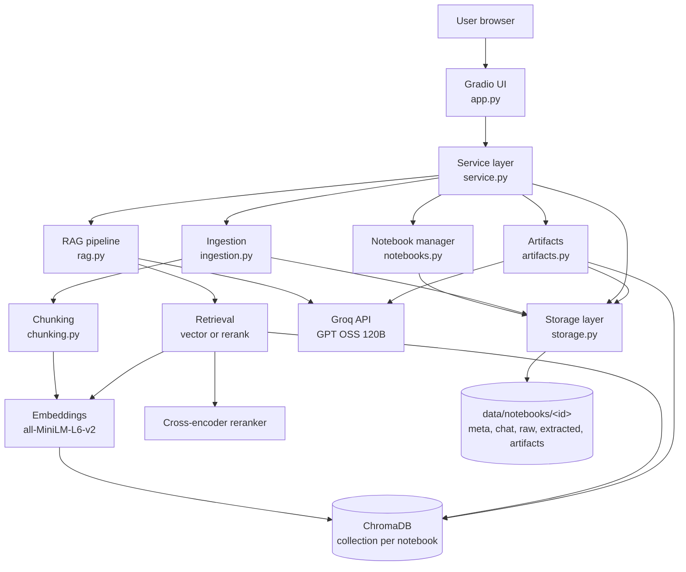

# Architecture

## Diagram



Plain-text version:

```
                    Gradio UI (app.py)
                           |
                 Service layer (service.py)
     ______________|_______|________|_____________
    |              |                |             |
 Notebooks     Ingestion         RAG Chat      Artifacts
    |              |                |             |
    |          Chunking         Retrieval  ---> Groq LLM <---
    |              |           /    |    \
    |          Embeddings ----     Reranker
    |              |                |
    |              +----> ChromaDB <+
    |
 Storage layer (storage.py) -> data/notebooks/<id>/...
```

## Major modules

| Module | Responsibility |
|---|---|
| `app.py` | UI layout and event handlers only. Turns errors into readable messages. |
| `service.py` | Single entry point for the UI. Coordinates ingestion, chat, and artifacts. |
| `storage.py` | Storage abstraction. The only module that touches file paths. Validates notebook IDs and writes JSON atomically. |
| `notebooks.py` | Create, rename, delete, list notebooks. Delete also removes the vector collection. |
| `ingestion.py` | Extracts text from PDF (per page), PPTX (per slide, tables, notes), TXT, and URLs (strips nav and scripts). |
| `chunking.py` | Splits text into about 1000-char chunks with 150-char overlap, snapping to paragraph or sentence boundaries. Attaches citation metadata. |
| `embeddings.py` | Loads the sentence-transformers model once (lazily) and embeds text. |
| `vectorstore.py` | ChromaDB wrapper: add, query, get all, delete by source, delete notebook. |
| `retrieval.py` | The two retrieval strategies: vector search and vector + reranking. Times each call. |
| `llm.py` | OpenAI-compatible client, so the provider can be changed with env variables. Handles timeouts and retries. |
| `rag.py` | Builds the grounded prompt, calls the LLM, normalizes and extracts the citations used. |
| `artifacts.py` | Picks chunks evenly across all sources, generates a report or quiz, saves it as `.md`. |

## Data flow

**Adding a source**
1. User uploads a file or enters a URL.
2. `ingestion.py` extracts text into sections (one per page or slide).
3. The raw file and extracted text are saved under the notebook folder.
4. `chunking.py` splits each section and attaches metadata.
5. `embeddings.py` embeds the chunks, and `vectorstore.py` stores them in the notebook's collection.
6. The source is added to the notebook's `meta.json`.

**Asking a question**
1. The question is embedded.
2. Top-k chunks are retrieved from the notebook's collection (optionally reranked).
3. Chunks are numbered and placed in a prompt that tells the LLM to answer only from them and cite `[n]`.
4. The answer plus a Sources list is shown and saved to `chat.json`.
5. The retrieved chunks, scores, and timing appear in the UI.

**Generating an artifact**
1. Chunks are sampled evenly from every source (up to about 24k characters) so all sources are covered.
2. The LLM writes a report or a quiz with an answer key, citing excerpts.
3. A header (notebook, date, sources) and an excerpt reference list are added.
4. The result is saved as `.md` in `artifacts/` and shown for viewing and download.

## Notebook storage

Each notebook has a UUID and a folder: `meta.json`, `chat.json`, `raw/`, `extracted/`, `artifacts/`. Vectors live in one ChromaDB database with a separate collection per notebook (`nb_<id>`), so notebooks never see each other's chunks. A single Chroma client avoids file-lock problems from opening many databases at once. All data reloads on restart.

On Cloud Run the disk is ephemeral, so data is lost when the container restarts or redeploys. Because all file access goes through `storage.py`, it could be swapped for Firestore or Cloud Storage without changing other modules.

## RAG pipeline

- **Chunking:** character windows with overlap, boundary-aware, per page or slide so citations stay exact.
- **Embeddings:** `all-MiniLM-L6-v2` (384 dims, fast on CPU, free).
- **Retrieval:** cosine similarity in ChromaDB (HNSW index).
- **Reranking (option 2):** retrieve 20 candidates, score each with `ms-marco-MiniLM-L-6-v2`, keep the top k.
- **Generation:** Groq GPT OSS 120B with a grounded system prompt, the last 6 chat messages for follow-up context, temperature 0.2, and low reasoning effort for speed.
- **Citations:** chunks are numbered in the prompt. The numbers the LLM uses are mapped back to source name and page or slide.

## Artifact generation

Reports and quizzes use the same context selection, which spreads chunks across sources instead of only taking the first pages of one document. The quiz prompt enforces a fixed format with a separate Answer Key section. Files are saved with timestamps so older versions stay available.

## Deployment architecture

```
Developer
   |
   v
GitHub (push to main)
   |------------------------------> GitHub Actions: syntax check + unit tests
   |
   v
Cloud Build trigger (cloudbuild.yaml)
   |-- docker build (installs deps, pre-downloads embedding + reranker models)
   |-- push image to Artifact Registry (notebook-repo, us-central1)
   '-- gcloud run deploy notebook-app
            |
            v
   Cloud Run service (Gradio UI + RAG backend in one container)
     |-- 2 GiB memory, 0 to 2 instances, 900s request timeout
     |-- LLM_API_KEY from Secret Manager
     |-- Groq API (LLM calls over HTTPS)
     '-- local disk: ChromaDB + notebook files (ephemeral)
```

Embedding and reranking run inside the container on CPU. Only the LLM is an external API.

## Design decisions

- **Service layer between UI and logic,** so the UI could be swapped (for example FastAPI + React) without touching the RAG code.
- **OpenAI-compatible LLM client,** which made it a two-line config change to move from Gemini to Groq when Gemini returned 503 overload errors.
- **Local embeddings,** so ingestion costs nothing and doesn't depend on an external API.
- **Models baked into the Docker image,** so cold starts don't download them again.
- **Lazy model loading,** so the app starts quickly and only loads the reranker if it's used.
- **Per-page and per-slide chunking** for precise citations.
- **Cloud Run instead of Hugging Face Spaces,** since Gradio Spaces now need a paid plan. Cloud Run scales to zero, so it costs almost nothing when idle.